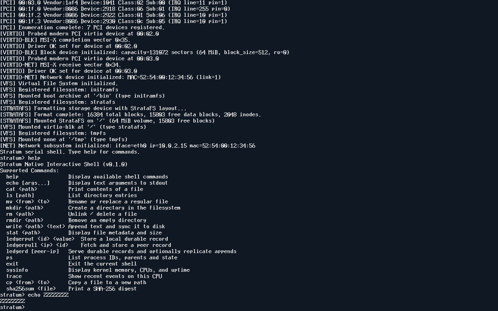

# Reproduce an acceptance run

Install the build and VM tools from the [quickstart](../README.md).
The [toolchain lock](../toolchain.lock) identifies the reference Apple
Silicon toolchain and firmware image. `make doctor` reports the
actual tools selected by the environment. Set `OVMF` to the intended
firmware file. The runner records the firmware digest and emulator
version with the source and images.

Full acceptance also needs the [pinned Linux reference ISO](spec/network-contract.md),
Zig, and an ISO9660-capable tar. Set `STRATUM_REFERENCE_ISO` to the
absolute path to that ISO. The runner uses an isolated checkout and
QEMU loopback links.

```sh
make doctor docs
make acceptance
make verify EVIDENCE=/absolute/path/to/acceptance/run
make test-acceptance-controls EVIDENCE=/absolute/path/to/acceptance/run
make release EVIDENCE=/absolute/path/to/acceptance/run
```

The soak takes at least one hour. A failed or interrupted campaign
leaves raw logs under its run directory. `python3 scripts/verify_evidence.py
--inspect /absolute/path/to/acceptance/run` checks integrity and the
completed gates of a finalized incomplete bundle. A complete release
requires successful verification, a published execution commit, and
checks against the hosted branch, CI run and downloadable assets.
`make release` packages a locally qualified run under `build/release/`.
It checks the local workload and control results and reads back every
archive member. It includes pristine images, symbols, the source and
SDK, and the evidence manifests. Hosted checks remain a separate step.

## Locate the proof

| Behavior | Workload and raw files inside the run |
| --- | --- |
| UEFI boot, active CPUs and rejected handoffs | `boot`, `raw/boot-campaign/results.json` and the per-case serial transcripts |
| Real nested TSS stacks | `entry-stacks`, `raw/entry-stacks/*cpu.log` |
| Guest panic bound to its build | `diagnostics`, `raw/diagnostics/faults-2.log` and `faults-2-symbols.json` |
| Concurrent workers and cancellation | `threads` and `cancellation`, the 4- and 8-CPU transcripts |
| Resource exhaustion and reuse | `resource-limits`, `raw/resource-limits/slab.log` and `sockets.log` |
| Journal recovery | `wal-crash`, `campaign.json` and the independent per-case checker logs |
| Guest TCP payloads | `tcp`, `tcp-recovery`, `tcp-reference`, the packet captures and result hashes |
| Durable records on two guests | `service`, the Ethernet capture, guest logs, and disk checks |
| One-hour resource accounting | `soak`, `rounds.jsonl`, `results.json`, and the raw checker output |
| Native benchmark observations | `guest-bench` and `benchmark-comparison`, raw samples and input identities |

`SOURCE_INPUTS.json` binds the run to tracked file bytes.
`MANIFEST.json` binds the retained files. `COMMANDS.jsonl` records
actual command exits. `features.json` maps the capability IDs to
observations and remaining requirements. Check the [status table](BUILD_STATUS.md)
before citing a workload result.

## Diagnose a failure

Use `make debug` to stop the guest at boot on GDB port 1234.
Load `build/stratum.elf` in GDB, connect with `target remote :1234`,
and use `hbreak _start` before continuing through UEFI. The boot
campaign also inspects entry registers through QEMU's debugger stub.

Use `make test-faults` for an intentional kernel trap and the resolved
ELF symbol. Use `trace [cpu]` in the guest for recent per-CPU records
and loss counts. [Trace ABI](spec/trace-format.md)

To inspect a persistent StrataFS volume, exit the guest first. Build
the independent checker with
`clang -O2 tools/strata_check.c -o build/strata_check` and run
`build/strata_check var/stratum-data.img`. The checker reads the raw
volume. A rejected mount leaves the disk available for offline
diagnosis. [Storage format](spec/storage-format.md)

## Captured framebuffer



QEMU q35 with TCG, 2 vCPUs, 256 MiB RAM, and `console=both`.
`make test-framebuffer` sends PS/2 keys and captures the display after
the shell renders a known glyph sequence. This image is a format
conversion of the raw QEMU capture from
`b124e4f4ac333c16da199cd94a2bf13fa31beb15`. The source boot template's
SHA-256 is `f5a5655e2a62ae8fc63a33fbd6e9fc3dcf76629a63ad4c69212a8777c97b36d2`.
The raw PPM SHA-256 is
`1da40b47d8c5f4690dc405c04ae513ae5175215e64e5bf3cf732a162d9ce373b`.
